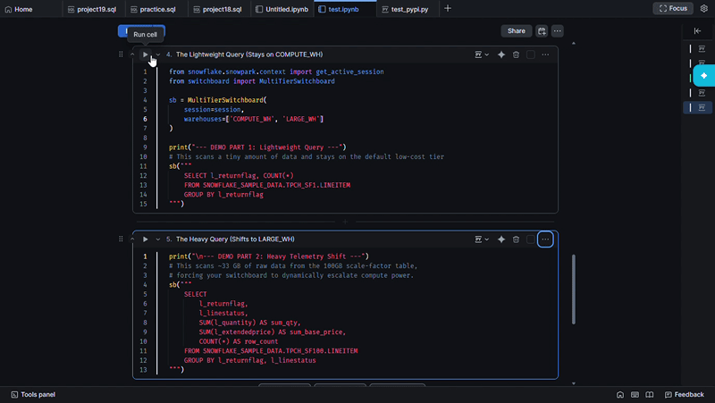

# Snowflake Switchboard AI (`snowflake-switchboard-ai`)

[](https://pypi.org/project/snowflake-switchboard-ai/)
[](https://opensource.org/licenses/MIT)
[](https://www.python.org/)

**`snowflake-switchboard-ai`** is a metadata-driven, zero-cost query router for **Snowflake and Snowpark**. 

It automatically inspects your query execution plan before execution to estimate projected data volumes (`bytesAssigned`), dynamically routing your queries to the optimal warehouse tier to maximize performance while minimizing compute costs.

## 🚀 Key Features

- **Zero-Cost Telemetry Analysis:** Uses Snowflake's native `SYSTEM$EXPLAIN_PLAN_JSON` to inspect query payloads without executing them or incurring compute charges.
- **Intelligent Tier Routing:** Automatically maps query byte sizes to your configured warehouse hierarchy.
- **Frictionless Execution:** Provides a clean callable shorthand syntax (`sb(...)`) that analyzes, routes, executes, and renders results automatically.
- **Flexible Configuration:** Works out of the box with sensible size defaults or accepts custom data thresholds tailored to your workload.

## 📦 Step-by-Step Guide

### Step 1: Installation
Install the package directly from PyPI into your environment or notebook:

```bash
pip install snowflake-switchboard-ai
```

### Step 2: Quick Start (Default Thresholds)
Simply pass your existing Snowpark `session` and ordered warehouse list. The switchboard automatically applies smart data size thresholds out of the box:

```python
from switchboard import MultiTierSwitchboard

# 1. Initialize with automatic default thresholds
sb = MultiTierSwitchboard(
    session=session,
    warehouses=["xsmall_wh", "small_wh", "medium_wh", "large_wh", "xlarge_wh", "xxlarge_wh"]
)

# 2. Run queries effortlessly using callable shorthand
sb("""
    SELECT c_mktsegment, COUNT(*)
    FROM SNOWFLAKE_SAMPLE_DATA.TPCH_SF1.CUSTOMER
    GROUP BY c_mktsegment
""")
```

### 📊 Default Threshold Mapping
When custom thresholds are not specified, `MultiTierSwitchboard` routes queries using these exact default payload limits:

| Warehouse Tier | Byte Boundary | Data Volume Limit |
| :--- | :--- | :--- |
| **Tier 1 (e.g., XS)** | `< 1,000,000,000 bytes` | Under 1 GB |
| **Tier 2 (e.g., Small)** | `< 5,000,000,000 bytes` | Under 5 GB |
| **Tier 3 (e.g., Medium)** | `< 20,000,000,000 bytes` | Under 20 GB |
| **Tier 4 (e.g., Large)** | `< 50,000,000,000 bytes` | Under 50 GB |
| **Tier 5 (e.g., X-Large)** | `< 100,000,000,000 bytes` | Under 100 GB |
| **Tier 6 (e.g., 2X-Large)** | `< 500,000,000,000 bytes` | Under 500 GB |

### Step 3: Custom Thresholds (Optional)
If you want granular control over when queries switch warehouse tiers, pass your own custom byte limits via `thresholds`:

```python
# Pass custom byte limits matching your warehouse boundaries:
sb = MultiTierSwitchboard(
    session=session,
    warehouses=["xsmall_wh", "small_wh", "medium_wh"],
    thresholds=[1_000_000_000, 10_000_000_000]
)
```

### 📸 Live Execution Output
Here is how `snowflake-switchboard-ai` looks in action inside a Snowflake Notebook:



## ⚙️ How It Works

- **Pre-Check Phase:** Intercepts query execution and executes `SYSTEM$EXPLAIN_PLAN_JSON(...)` at zero compute cost.
- **Telemetry Analysis:** Recursively parses the JSON plan tree to calculate estimated `bytesAssigned`.
- **Dynamic Routing:** Automatically executes a fast `USE WAREHOUSE <optimal_tier>` before triggering data retrieval.

## 🛠️ Requirements

- Python `3.8+`
- `snowflake-snowpark-python >= 1.0.0`

## 📜 License

Distributed under the **MIT License**. See `LICENSE` for more information.
